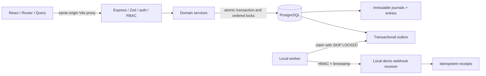

# Architecture



## Boundaries

- `packages/shared`: product strings, request validation, exact amount parser.
- `apps/api/src/modules/auth`: hashing, session lifecycle, token verification, routes.
- `ledger`: posting primitives, account provisioning, ordered wallet locking, audit.
- `transfers`: durable intent serialization, state changes, review, full reversal; domain routes provide auth and input boundaries.
- `risk`: deterministic pure score calculation and versioned explanatory signals.
- `admin`: topup approval and snapshot reconciliation.
- `webhooks` / `workers`: authenticated local event transport. Never mutate money.
- `apps/web/src/features`: public, wallet, transfer, account and operations screens.

## Transfer sequence

```mermaid
sequenceDiagram
 participant U as Browser
 participant A as API
 participant D as PostgreSQL
 U->>A: POST transfer + stable Idempotency-Key
 A->>A: Authenticate, validate intent
 A->>D: BEGIN; advisory lock(actor,scope,key)
 alt Existing intent
  D-->>A: Stored response or payload conflict
 else New intent
  A->>D: Lock sender and recipient wallets in UUID order
  A->>D: Read fresh balances and sender activity
  A->>A: Evaluate deterministic risk rules
  alt Needs review
   A->>D: Persist PENDING_REVIEW + reasons + audit
  else Allowed and funded
   A->>D: Journal + debit + credit + COMPLETED + audit + outbox
  else Unfunded/frozen
   A->>D: Persist FAILED; no journal
  end
  A->>D: Persist idempotency response
 end
 A->>D: COMMIT; deferred balanced-journal validation
 A-->>U: Stable JSON result
```

A lost response after commit is recoverable using the same key/body. A failure before commit rolls back the complete intent; retry safely recreates it. A request held for review does not reserve funds. Approval locks the intent, locks wallets, and reads fresh balances before posting.

## Local deployment

API 4000; Vite 5173 with `/api` proxy; PostgreSQL socket port 55432. Test servers use 4001/5174 and a separate DB. No browser code receives database credentials. No external telemetry. Worker delivery is bounded (2.5 seconds), exponential backoff up to 10 attempts, then visible as exhausted; operational recovery is a controlled local SQL update (documented in API notes), not a hidden automatic money retry.
