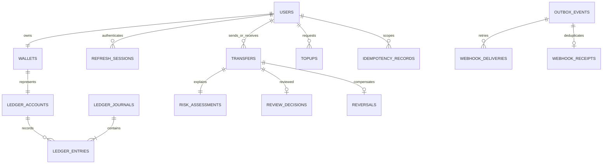

# Data model and ledger invariants

`001_foundation.sql`: users, sessions, wallets, ledger accounts/journals/entries, append-only audit, ledger balance view, SQL trigger constraints.
`002_transfers.sql`: transfer intents, durable idempotency, assessments, decisions, topups, reversals, reconciliation, outbox.
`003_events.sql`: immutable delivery attempts and deduplicated receipts.

All money is positive integer paise in BIGINT, returned as JSON strings. Decimal input uses a strict digit parser and `bigint`; no financial arithmetic uses binary floating point. The maximum accepted transfer representation is ₹999,999,999.99 (99,999,999,999 paise). Presentation formats whole rupees with `Intl.NumberFormat('en-IN')` over bigint and appends the exact paisa remainder.

## Sign convention

User wallets are liabilities. Wallet balance = credits − debits. The system issuance offset is the balancing account, with net debits.

| Journal      | Account       | Debit paise | Credit paise |
| ------------ | ------------- | ----------: | -----------: |
| Issue ₹2,000 | System offset |      200000 |            0 |
| Issue ₹2,000 | Rahul wallet  |           0 |       200000 |
| Send ₹500    | Rahul wallet  |       50000 |            0 |
| Send ₹500    | Priya wallet  |           0 |        50000 |

Each journal has at least two entries and equal debits/credits. The creating transaction ID prevents late entry insertion. UPDATE/DELETE triggers preserve entries, journals, audit, risk, decisions, reversals, receipts and reconciliation. Database owners can bypass triggers; normal application behavior cannot.

Balances are not cached. The `wallet_balances` view derives them. Transfer/topup/reversal services serialize changes with wallet-row locks, reading fresh aggregates after lock acquisition. Negative balance prevention lives in those services; direct privileged low-level journal writes can bypass that check. A dedicated test deliberately does so to prove reconciliation catches it and restores with a compensating posting.

## State model

CREATED → PENDING_REVIEW, PROCESSING, or FAILED.
PENDING_REVIEW → PROCESSING, REJECTED, or FAILED.
PROCESSING → COMPLETED or FAILED.
Terminal transfers cannot be rewritten. SQL checks require COMPLETED iff journal_id exists. The service traverses PROCESSING inside the same transaction; consumers see only committed final/held state. Approved-but-unfunded requests become FAILED. Reversal leaves the original COMPLETED transfer intact and adds a separate unique reversal.

A transfer's sender, recipient, amount, currency, note and reference are immutable. One effective review and one full reversal are guaranteed by unique constraints. Idempotency scope is (actor, operation, key), with canonical payload fingerprint and stable serialized result. Records are retained indefinitely in this demo.

## Migrations 004–005

`reversal_requests` links sender, original transfer, reviewer and (only on successful approval) one financial reversal. A partial unique index prevents duplicate pending requests, and a trigger enforces terminal-state immutability, original sender ownership and matching reversal linkage. `transfer_verifications` stores challenge IDs/HMACs, expiry, attempt/send counts, delivery state and consumption time; it never stores plaintext codes. See [migration and policy notes](REVERSALS_AND_OTP.md#migrations).

Migration 006 extends reversal requests with `QUEUED` and `queued_at`, makes the active uniqueness constraint cover pending and queued requests, adds `wallet_spendable_balances` as a reservation projection, and records `refresh_sessions.last_activity_at` for server-side inactivity expiry.

Migration 007 adds a partial `(created_at,id)` index for pending verification expiry. Payment expiry is fixed at creation + 15 minutes; OTP challenge resends do not alter it. Expiry uses the existing `FAILED` terminal state and an audit event, without a ledger journal.
